# Hi, I'm Khai

- Computer Engineering student at Brawijaya University, Malang
- Interested in **Computer Vision**, **Deep Learning**, and **Machine Learning**
- Focused on **on-device AI deployment** for **mobile and resource-constrained systems**

---

## What I Do
- Build and deploy **computer vision pipelines**
- Optimize deep learning models for **limited hardware**
- Integrate AI models into **mobile and embedded applications**
- Explore practical applications of **ML & DL**

---

## Languages I actually write

<picture>
  <source media="(prefers-color-scheme: dark)" srcset="assets/languages-dark.svg">
  <source media="(prefers-color-scheme: light)" srcset="assets/languages-light.svg">
  
</picture>

Counted from my own public repositories, forks and archived ones left out. The
card is drawn by [scripts/langcard.py](scripts/langcard.py) and redrawn by a
[workflow](.github/workflows/languages.yml) on every push and once a day, so it
is never waiting on someone else's server.

---

## Currently building

- **[tsunagu-pad](https://github.com/khaichi11/tsunagu-pad)** — turns an iPad
  into a second screen for Ubuntu over Wi-Fi, with Apple Pencil input and no app
  to install on the iPad. Written in C with GStreamer and WebRTC.

---

## Tech Stack

### Programming Languages

  
  
  
  

### Frameworks & Tools

  
  
  
  
  
  
  
  
  
  
  

---

## Links
- Portfolio: https://portfolio-khairuramdhani.web.app
- GitHub: https://github.com/khaichi11
- LinkedIn: https://www.linkedin.com/in/khairuramdhani
